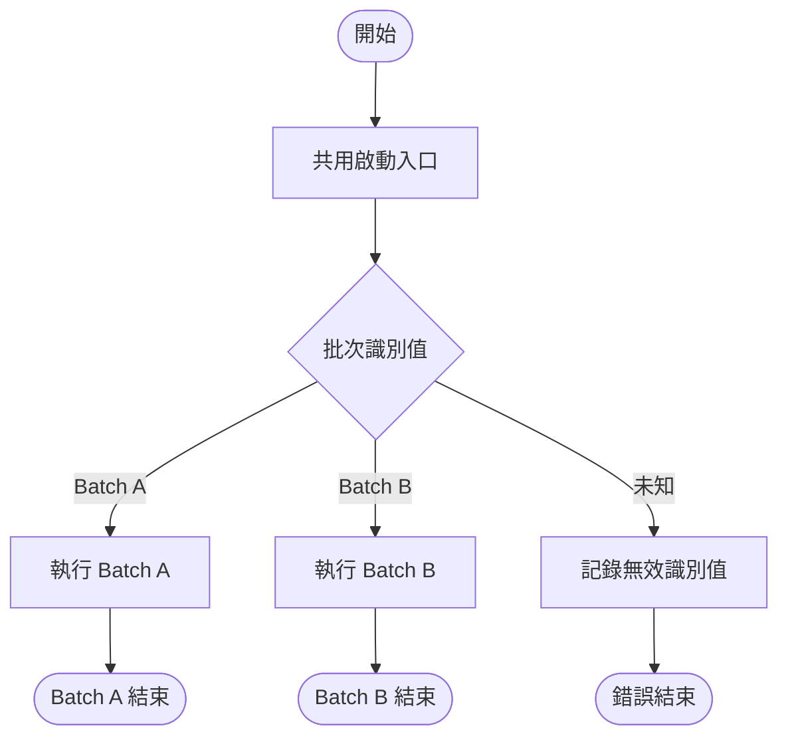
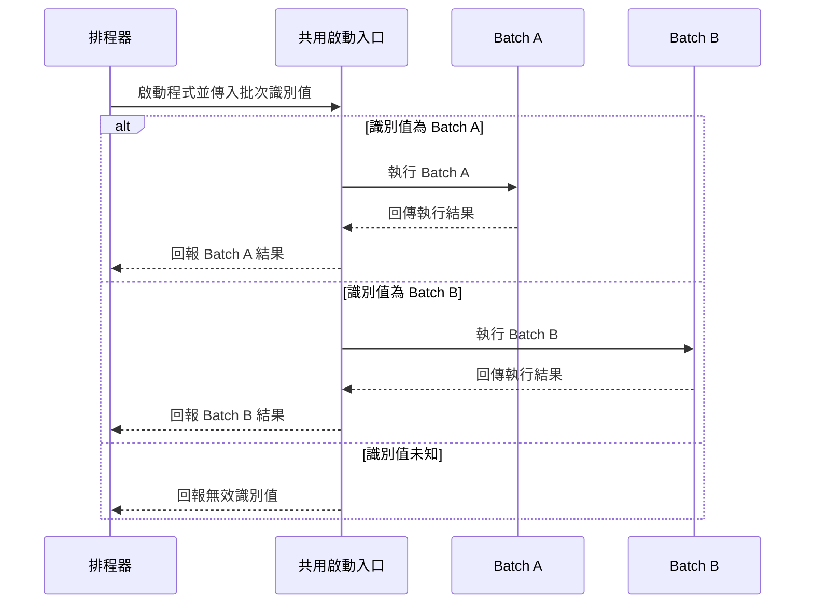

# 批次程式規格：<批次程式名稱>

## 編輯記錄

| 修改日期 | 修改人員 | 簡易說明 |
| --- | --- | --- |
| YYYY-MM-DD | <姓名或待確認> | <用一句話說明本次建立或修改內容> |

## 目的與範圍

<說明此批次程式要解決的問題、處理範圍，以及不包含的範圍。>

## 批次組成與啟動方式

- Repo 組成：<單一批次／多個獨立批次>
- 程式啟動入口：<執行檔、main class、command 或待確認>
- 批次選擇方式：<CLI 參數、環境變數、設定檔、排程命令或不適用>

| 批次名稱／ID | 職責 | 啟動識別值 | 觸發方式與頻率 | 相依批次 |
| --- | --- | --- | --- | --- |
| <Batch A> | <此批次負責的功能> | <job-a 或不適用> | <排程、事件、手動執行或待確認> | <無、批次名稱或待確認> |

> 多批次共用單一入口時，入口只負責啟動、驗證與分派。除非需求明確定義相依關係，否則各批次視為可獨立執行。

## 輸入與輸出

| 批次名稱／ID | 輸入 | 輸出 |
| --- | --- | --- |
| <Batch A> | <來源、格式、必要欄位與驗證條件> | <產出資料、檔案、狀態更新、通知或報表> |

## 功能邏輯

### 共用啟動與分派邏輯

<!-- 只有共用啟動入口時保留此節；完成稿中移除此註解。 -->

#### Step 1：<讀取並驗證批次識別值>

- 觸發／輸入：<啟動命令與批次識別值>
- 處理邏輯：<驗證識別值並選擇對應批次>
- 輸出／狀態變更：<啟動指定批次>
- 失敗處理：<未知識別值的錯誤、日誌與結束狀態>

### <Batch A：批次名稱>

#### Step 1：<步驟名稱>

- 觸發／輸入：<此步驟接收的內容>
- 處理邏輯：<規則、判斷、轉換或查詢>
- 輸出／狀態變更：<此步驟的結果>
- 失敗處理：<重試、略過、中止、告警或待確認>

#### Step 2：<步驟名稱>

- 觸發／輸入：<此步驟接收的內容>
- 處理邏輯：<規則、判斷、轉換或查詢>
- 輸出／狀態變更：<此步驟的結果>
- 失敗處理：<重試、略過、中止、告警或待確認>

<!-- 依實際流程增減 Step；多批次時為每個批次建立獨立小節並重新從 Step 1 編號；完成稿中移除此註解。 -->

## 例外與復原

<分別說明共用入口與各批次的錯誤分類、重試與冪等策略、部分成功處理、告警方式，以及重新執行原則。各批次的失敗與復原互不影響，除非需求另有定義。未知項目放入待確認事項。>

## Mermaid 流程圖

## Mermaid 時序圖

# 待確認事項

- TBD-001（影響：<章節或 Step>）：<可由需求方明確回答的問題？>
