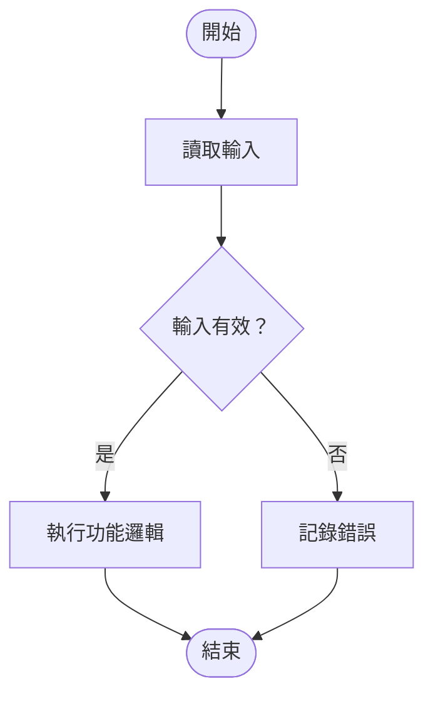
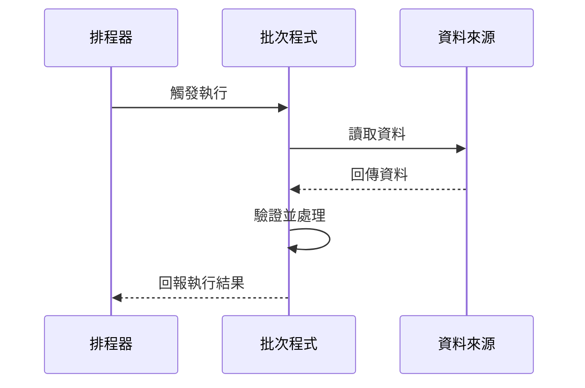

# 批次程式規格：<批次程式名稱>

## 編輯記錄

| 修改日期 | 修改人員 | 簡易說明 |
| --- | --- | --- |
| YYYY-MM-DD | <姓名或待確認> | <用一句話說明本次建立或修改內容> |

## 目的與範圍

<說明此批次程式要解決的問題、處理範圍，以及不包含的範圍。>

## 執行條件

- 觸發方式：<排程、事件、手動執行或待確認>
- 執行頻率／時間：<已知內容或待確認>
- 前置條件：<必要檔案、資料狀態、相依服務或無>

## 輸入與輸出

### 輸入

<列出來源、格式、必要欄位與驗證條件。>

### 輸出

<列出產出資料、檔案、狀態更新、通知或報表。>

## 功能邏輯

### Step 1：<步驟名稱>

- 觸發／輸入：<此步驟接收的內容>
- 處理邏輯：<規則、判斷、轉換或查詢>
- 輸出／狀態變更：<此步驟的結果>
- 失敗處理：<重試、略過、中止、告警或待確認>

### Step 2：<步驟名稱>

- 觸發／輸入：<此步驟接收的內容>
- 處理邏輯：<規則、判斷、轉換或查詢>
- 輸出／狀態變更：<此步驟的結果>
- 失敗處理：<重試、略過、中止、告警或待確認>

<!-- 依實際流程增減 Step；完成稿中移除此註解。 -->

## 例外與復原

<說明錯誤分類、重試與冪等策略、部分成功處理、告警方式，以及重新執行原則。未知項目放入待確認事項。>

## Mermaid 流程圖

## Mermaid 時序圖

# 待確認事項

- TBD-001（影響：<章節或 Step>）：<可由需求方明確回答的問題？>
